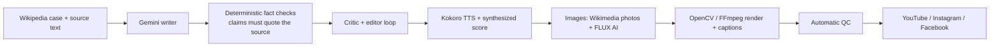

# MysteryStudio

**A fully automated, free-tools video studio.** It researches real mystery cases, writes and fact-checks the script,
narrates it, renders a documentary-style vertical video, publishes it on a schedule, replies to comments and emails
me when something breaks. It runs unattended on GitHub Actions.

## How it works



## Highlights

- **Grounded scripts:** every factual claim must carry an exact quote from the Wikipedia source, and unsupported claims are deleted, not reworded.
- **Advertiser-friendly by construction:** wording and source filters keep graphic cases out.
- **Per-video variety:** colour grade, caption style, voice, music mood and story structure change from video to video.
- **Relevant visuals:** real, freely licensed Wikimedia photos (with credits) mixed with AI images written for each scene.
- **Built to survive free tiers:** model fallback, quota and outage handling, retries, multiple scheduled attempts per slot and duplicate protection.
- **Review mode:** the first videos go out as private uploads with the video emailed for approval.

## Code map

```
mysterystudio/
  research.py     case discovery + Wikipedia source text
  scriptgen.py    writer -> deterministic fact checks (claim quotes, numbers) -> critic -> editor loop
  tts.py          Kokoro (CPU) with Edge-TTS fallback, one clip per scene
  music.py        original synthesized score, impacts, risers, voice ducking
  visuals.py      Wikimedia photos, Cloudflare/HF FLUX, Pollinations, procedural fallback
  render.py       camera moves, grade, text cards, crossfades -> ffmpeg
  captions.py     word-highlight ASS captions
  qc.py           resolution, duration, black frames, silence, loudness, blank-frame checks
  publish_*.py    YouTube Data API / Instagram + Facebook Reels
  comments.py     triage + replies, flags sensitive comments for you
  cli.py          run | comments | check | report
.github/workflows/  produce-videos, reply-to-comments, daily-report, check-credentials
```
**Setup:** see [SETUP.md](SETUP.md).
